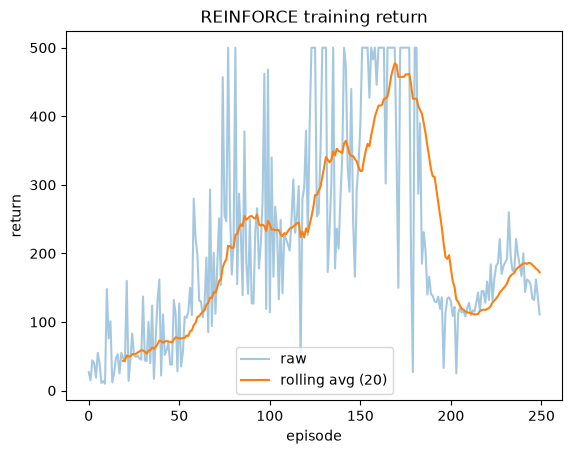
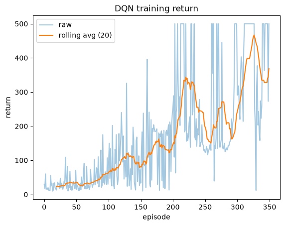

# Lab 2 Report: REINFORCE and DQN on CartPole-v1

## 1. What I did

- `discounted_returns`: goes backwards through the rewards, `G = r + gamma * G`, and returns a float32 tensor. The test `[1,0,2], γ=0.9 → [2.62, 1.8, 2.0]` passed.
- `policy_loss`: `-(log_probs * returns).sum()`. The minus is there because the optimizer minimizes.
- `dqn_targets`: `r + gamma * (1 - done) * max Q_target(s')`. The test passed: 5.5 for a non-terminal transition and 1 for a terminal one.
- DQN update: `gather` gives Q(s,a), the target comes from the target network inside `torch.no_grad()`, then MSE loss and an Adam step.

REINFORCE: 250 episodes, γ = 0.99, Adam lr = 0.01. DQN: 350 episodes, ε-greedy (1.0 → 0.05), replay buffer of 10,000, batch 64, and the target network is copied every 200 steps.

## 2. Training curves (seed 42)

## 3. Comparison over 3 seeds (mean return of the last 20 episodes)

| Seed | REINFORCE | DQN |
|---|---|---|
| 42 | 172.4 | 368.6 |
| 0 | 83.2 | 395.4 |
| 1 | 172.1 | 145.7 |
| **Mean (std)** | **142.6 (42.0)** | **303.2 (111.9)** |

DQN has the higher mean in runs, but the results change a lot between seeds and I only used 3, so I can't say DQN is better in general. REINFORCE is very noisy because the full-episode return has high variance. DQN starts slowly because ε is high at the beginning.

## 4. Explanations

**Why is the policy stochastic?** Sampling actions from probabilities gives exploration automatically. The gradient also needs log π(a|s), which only works when the policy is a probability distribution.

**Why does REINFORCE need the episode return?** It has no value function, so it judges each action by the real return after it, and that is only known at the end of the episode.

**Why do replay and target networks help?** Random mini-batches break the correlation between steps and reuse old data. The target network keeps the TD target fixed for 200 steps, so training is more stable.

**DQN vs REINFORCE.** REINFORCE learns the policy directly from complete returns (on-policy, Monte Carlo). DQN learns Q-values and updates every step with a bootstrapped target, using a replay buffer (off-policy).

## 5. Answers

(a) `PolicyNet` (REINFORCE) outputs action probabilities. (b) REINFORCE uses complete returns. (c) DQN bootstraps. (d) DQN uses replay. (e) For a terminal transition, (1 − done) = 0, so the target is just y = r. There is no future after the episode ends.
