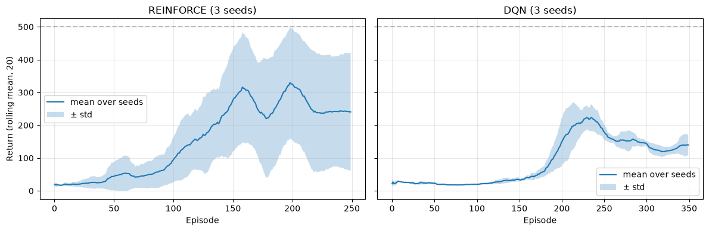

# Lab 2 Report: REINFORCE and DQN on CartPole-v1

**Notebook:** `lab2_reinforce_dqn.ipynb` (all cells executed)
**Seeds:** 0, 1, 2 (`random`, `numpy` and `torch` are seeded, and every episode resets the env with `seed*10000 + episode`)
**Versions:** Python 3.14.7, PyTorch 2.15.0, Gymnasium 1.4.0, NumPy 2.5.4, Matplotlib 3.11.2 (CPU only)

## 1. What I implemented

**Part A: REINFORCE.** The policy net is 4 → 64 → 2 with softmax. `discounted_returns` computes G_t backwards (G = r + γG). `policy_loss = -Σ log π(a_t|s_t)·G_t`, with a minus because the optimizer minimizes. Training: 250 episodes, γ = 0.99, Adam lr = 0.01. I also normalize the returns inside each episode, which works like a simple baseline and makes training less noisy.

**Part B: DQN.** The Q-net is 4 → 128 → 128 → 2 with no softmax. `dqn_targets = r + γ(1 − done)·max Q_target(s')`. In the update I gather Q(s,a), compute the target with the target network under `no_grad`, and minimize the MSE. Training: 350 episodes, γ = 0.99, Adam lr = 5e-4, replay memory of 50k, batch 64, ε goes 1.0 → 0.05 over 10k steps, and the target network is copied every 500 steps. Only `terminated` counts as done. Time-limit truncation does not.

**Unit tests (all passed):** `discounted_returns([1,1,1], 0.5) = [1.75, 1.5, 1.0]`. `policy_loss` gives the hand-computed value 2.0 and has the correct gradient sign. `dqn_targets` gives 10 for a non-terminal transition and exactly r = 1 for a terminal one. On a small buffer, the `dqn_update` loss drops from 1.07 to 0.004.

## 2. Results

Mean return over the final 20 episodes:

| Seed | REINFORCE | DQN |
|---|---|---|
| 0 | 92.0 | 183.0 |
| 1 | 136.9 | 108.2 |
| 2 | 492.5 | 128.8 |
| **Mean ± std** | **240.5 ± 179.2** | **140.0 ± 31.5** |

Both methods clearly beat random play (about 20). REINFORCE has a higher mean, but that comes mostly from seed 2, which solved the task (500). Seed 1 reached about 380 and then collapsed, so the variance between seeds is very large. DQN learns nothing for the first ~150 episodes because ε is still high. It then jumps to about 200 and settles at 110–180, and its seeds are much closer together. With 3 seeds and this much spread, I can't claim that one method is better in general.

## 3. Explanations

**Why is the policy stochastic?** Sampling from the probabilities gives exploration automatically. The gradient also needs log π(a|s), and that only works for a smooth probability distribution, not for an argmax.

**Why does REINFORCE need the episode return?** It is a Monte Carlo method with no value function. The only way it can judge an action is the real return that came after it, so it has to wait until the end of the episode. This is also why it has high variance.

**Why do replay memory and target networks help?** Consecutive transitions are correlated. Random mini-batches from the replay memory break that correlation and let each transition be reused. The target network stays fixed for 500 steps, so the TD target is not a "moving target", which makes training more stable.

**DQN vs REINFORCE.** REINFORCE learns the policy directly. It is on-policy and uses full returns once per episode. DQN learns Q-values and acts with ε-greedy. It is off-policy, updates every step with a bootstrapped TD target, and reuses old data.

## 4. Answers

- **(a)** The REINFORCE policy network outputs action probabilities. DQN outputs Q-values.
- **(b)** REINFORCE uses complete returns.
- **(c)** DQN bootstraps, because its target uses its own estimate max Q(s′).
- **(d)** DQN uses replay.
- **(e)** For a terminal transition (done = 1), the term γ(1−done)·max Q becomes 0, so the target is just y = r. There are no future rewards after the episode ends.
